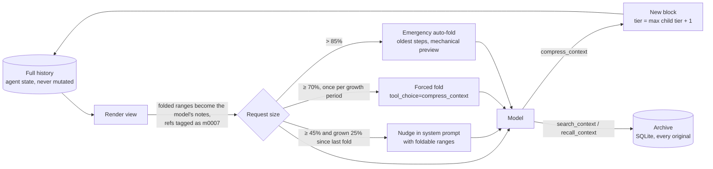

# Context-compact

Model-driven, recoverable **context compaction for LangChain agents**, a golden dataset to
evaluate it, a web UI to watch it work, and an experiment that runs the same agent with and
without it on **free Groq models**.

A plain tool-using agent re-sends its whole history on every step. Requests grow with every
tool result, total cost grows roughly quadratically, and sooner or later the request no longer
fits. On Groq's free tier that wall is close: a single request cannot exceed the model's
tokens-per-minute limit (8K for gpt-oss, 7K input for Qwen). This library keeps each request
inside a fixed token window by letting **the model fold its own finished work into notes**.
Nothing is thrown away: every original message stays in an archive that the model can search
and recall.

```python
from langchain.agents import create_agent
from langchain_groq import ChatGroq
from context_compact import ContextCompactionMiddleware, RateLimitMiddleware

agent = create_agent(
    ChatGroq(model="openai/gpt-oss-120b", max_retries=0),
    tools=[...],
    middleware=[
        ContextCompactionMiddleware(window=6_000),  # keep every request under 6K tokens
        RateLimitMiddleware(tpm_limit=8_000),        # pace, wait out 429s, fall back on daily quota
    ],
)
```

## How it works



* **History and view are separate.** The agent's LangGraph state keeps every message. A
  `wrap_model_call` middleware renders a compacted *view* for each model call. Each folded
  range is replaced, in place, by an assistant message holding the model's own notes
  (`[Notes on m0004-m0011 · fold b002 …]`). User and tool messages get ids like `[m0007]` so
  the model can refer to them.
* **The model decides what to fold.** It gets a `compress_context(start_ref, end_ref, topic,
  summary)` tool and writes the summary itself. The rules it is given are short: fold once a
  range is no longer needed word for word, fold right after extracting what you need, keep every
  exact value, drop noise, trust your notes.
* **Nudges are growth-gated, then escalate.** The model is nudged only once the request is at
  least 45% of the window *and* has grown by 25% of the window since the last fold, so it isn't
  nagged every turn. The nudge lists concrete foldable ranges with their sizes and goes in the
  **system prompt**. Above 70%, one call per growth period is made with
  `tool_choice=compress_context`, so the model *must* fold but still chooses the range and writes
  the summary. If the provider rejects the forced call, it is retried unforced.
* **Folds are hierarchical.** Folding a range that contains earlier folds creates a higher-tier
  block whose `children` are those folds. Lineage is kept, and nudges suggest merging once
  several folds pile up.
* **Nothing is lost.** Originals live in an SQLite archive (in memory, or a file you can
  inspect). `search_context(query)` greps folded history. `recall_context("b003" | "m0007")`
  shows originals without unfolding them.
* **Tool calls stay paired.** An assistant tool-call message and its tool results form one
  unit. Ranges are widened to whole units, so the view never contains an orphaned tool
  message, which OpenAI-compatible APIs would reject.
* **Protected messages.** The original task and the latest user message are never folded.
  Old `compress_context` receipts are hidden, since their content is already in the notes.
* **Emergency fallback.** If the model ignores nudges and a request passes 85% of the window,
  the oldest *already seen* steps are auto-folded into mechanical previews (tool name, arguments
  and the start of each result), down to 55%. These are lossy previews of lossless archives:
  exact text is still one `search_context` away.
* **Calibrated token estimates.** Sizes are estimated with tiktoken, and a correction ratio is
  learned from each response's reported `input_tokens`.

### What we learned on real models

Each of these showed up in live runs on Groq's free models; the first four changed the design, and the last two are open:

1. **Nudges inside tool output get ignored.** The first version appended the nudge to the newest
   tool result. gpt-oss-120b never folded, because models trained with an instruction hierarchy
   discount instructions found in tool output (a prompt-injection defence). Every fold came from
   the lossy emergency path. Moving the nudge to the system prompt fixed it.
2. **Summaries in the system prompt read as instructions, not memory.** Folds were first listed
   as a digest in the system prompt. The model's summaries were accurate, but after each fold it
   re-listed the files and started over (6 re-reads in 26 calls). Rendering each fold *in place*,
   as the model's own assistant-role notes, fixed the restarts.
3. **Forced tool choice can be refused.** With `tool_choice=compress_context`, gpt-oss-20b still
   tried to call `read_file`, and Groq rejected the response. The compactor now retries once
   without forcing, and the retry layer no longer resamples that error.
4. **Per-model limits differ.** Qwen3.8-27B caps *input* tokens at 7K per minute, not 8K. The
   plain agent read all 8 files in one parallel step and hit that wall right away. The pacer now
   takes per-model limits.
5. **Open: lossy auto-folds make weak folders restart.** gpt-oss-20b never folded by itself, so
   only auto-folds ran. They keep the start of each tool result, which for these files is a
   docstring with no values. The model lost the facts, re-listed the files and started over (13
   re-reads). Next: keep the lines that carry numbers, ids and key = value pairs, or write the fold
   with a small summarising call when the model refuses.
6. **Open: our own paging hint caused a recall loop.** A truncated `recall_context` result says
   "continue with recall_context('m…')". Qwen followed it 22 times in a row, 31 times in all, until the
   request overflowed the window, without ever answering.
   Next: drop the hint, point to `search_context`, and refuse a repeat recall of the same range.

### Relation to billion-context

The design borrows ideas from [ranxianglei/billion-context](https://github.com/ranxianglei/billion-context)
and its paper on model-driven incremental hierarchical compression: the model choosing its own
folds, tiered blocks with lineage, growth-gated nudges, and recoverable originals. This
repository is an independent, much smaller reimplementation written from scratch in Python.
It is not a port. billion-context is a production proxy that sits between a coding agent and
its API. This is a LangChain `create_agent` middleware meant for experiments. It does not
reproduce billion-context's cache-preserving layout, its multi-host features or its tuning.

## Where to use it

Anywhere an agent's history grows with tool output faster than it can afford to re-send it.
Each example in [`examples/`](examples/) is a runnable agent on Groq's free tier with a 5–6K window.

| Use case | Why history explodes | Example |
|---|---|---|
| **Coding assistant over a repo** | every file read is 1–10K tokens | `python examples/repo_assistant.py ~/code/app "Where is auth handled?"` |
| **Incident / log triage** | logs are huge, mostly noise; the ids that matter are tiny | `python examples/log_triage.py /var/log/myapp` (no argument: a generated incident) |
| **Research over many documents** | synthesis needs facts from *every* document | `python examples/doc_research.py ~/notes "What did we decide about pricing?"` |
| **Long support chats** | dozens of turns, each with order/ticket lookups | `python examples/support_chat.py` |
| **Free or small-context models** | 8K free-tier requests, local 8K models, cheap tiers | any of the above |

What it is *not* for: single-shot prompts, or agents whose history already fits comfortably.
There, compaction only adds a few hundred tokens of rules and an occasional extra call.

```python
# drop it into an existing agent: nothing else changes
middleware = [ContextCompactionMiddleware(window=6_000), RateLimitMiddleware()]
agent = create_agent(model, your_tools, system_prompt=your_prompt, middleware=middleware)
```

## Quick start

```bash
git clone https://github.com/Pranay0083/Context-compact.git && cd Context-compact
uv venv --python 3.12 && uv pip install -e ".[dev,server]"
cp .env.example .env                                   # add GROQ_API_KEY (free at console.groq.com)
.venv/bin/python -m pytest                             # offline tests, no key needed
.venv/bin/python -m experiment.run --fake --golden     # offline dry run of the whole golden eval (~2s)
.venv/bin/python -m experiment.run --size medium -v    # live: baseline vs compact on Groq
```

### Web UI (Next.js + FastAPI)

```bash
CC_FAKE_LLM=1 .venv/bin/uvicorn server.app:app --port 8000   # offline demo model, or drop CC_FAKE_LLM for Groq
cd web && npm install && npm run dev                          # http://localhost:3000
```

* **Playground**: chat with the plain or the compacting agent over either sandbox, using the
  graded preset questions or your own. Events stream in live: model calls, tool results, folds,
  rate-limit countdowns and fallbacks. The inspector shows the request size against the window
  and the provider limit, every fold with the summary the model wrote, exactly what the model
  saw on its last call, and a tokens-per-call chart.
* **Compare**: run both agents on the same question, one after the other, side by side.
* **Results** and **Golden**: browse experiment runs and golden evals.
* **Demo**: a guided presentation flow; see [DEMO.md](DEMO.md).

`CC_FAKE_LLM=1` swaps in a scripted model that explores, folds and answers like an agent, and it
enforces the same simulated 8K request limit. The plain agent still hits the wall, so the whole
demo works with no key and no quota. API contract: [server/API.md](server/API.md).

### Surviving free-tier limits

`RateLimitMiddleware` (in `context_compact.limits`) makes agents keep going on free tiers:

| Limit | What happens |
|---|---|
| Tokens per minute | Requests are **paced** client-side per model (sliding 60s window), so 429s are rare |
| 429 with *"try again in 7.5s"* | It waits exactly that long and retries |
| Daily quota (TPD), short wait | Daily windows roll, so near the limit *"try again in 4m50s"* is common; it waits (up to `max_daily_wait`, default 15 min) |
| Daily quota, long wait | It **falls back** to the next model in `fallbacks`, otherwise raises `DailyQuotaExceeded` saying when to come back |
| `tool_use_failed` | The model emitted a malformed tool call; resampled up to 3 times |
| Request too large (413) | Never retried: that is the per-request ceiling, which compaction exists to avoid |

Experiment runs save after every agent run. If a quota stops one,
`python -m experiment.run --resume results/<run>` continues where it left off.

### CLI flags

`--model`, `--tasks service_audit,incident_trace`, `--arms baseline,compact`, `--window 6000`
(compact budget), `--baseline-window` (cap the baseline too), `--size small|medium|large`,
`--all-turns` (also ask the follow-ups), `--golden [path] --cases id,…`, `--resume DIR`,
`--fallback-models m1,m2`, `--tpm 8000` (pacing; 0 = off), `--max-daily-wait 900`, `--fake`,
`-v` (print every model call). `--provider xai` works too, after `pip install -e ".[xai]"` and
setting `XAI_API_KEY`, but xAI's Grok API has no free tier.

### Configuration

`ContextCompactionMiddleware(window=..., **CompactionConfig fields)`:

| Field | Default | Meaning |
|---|---|---|
| `window` | 16000 | Token budget for one request (system + tools + messages) |
| `nudge_ratio` | 0.45 | Nudge once the request is this full… |
| `growth_ratio` | 0.25 | …and has grown this much (× window) since the last fold |
| `force_ratio` | 0.70 | Above this, one call per growth period forces `compress_context` |
| `emergency_ratio` | 0.85 | Auto-fold above this |
| `emergency_target_ratio` | 0.55 | Auto-fold down to this |
| `auto_keep_recent_units` | 1 | Auto-fold never touches the newest step (the model hasn't seen it yet) |
| `recall_max_tokens` | window / 4 | Cap on one `recall_context` result |
| `nudge_placement` | `"system"` | Or `"message"` to append the nudge to the last message |
| `strict` | True | Raise `ContextOverflowError` if a request still doesn't fit |

`archive_path="run.sqlite"` persists the archive (tables `messages` and `blocks`) so you can
inspect what was folded after a run.

## Evaluation

### Workloads

Two deterministic synthetic sandboxes, generated from a seed, with exact answers:

* **`service_audit`**: a fake repo of service modules, each ~650–1,100 tokens of plausible code
  with a `SERVICE_CONFIG` dict buried mid-file. Questions aggregate exact values across *all*
  files (timeouts over a threshold with owners, a sum over a region, an argmax over dependents),
  so summaries must keep exact numbers. It includes a boundary case (`timeout_ms == 2000`) and
  changelog comments as distractors.
* **`incident_trace`**: service logs, each ~850–1,400 tokens of noise, hiding a multi-hop root
  cause: gateway 502 → checkout request id → payments trace → ledger txn → table lock → the
  scheduler job holding it. There are distractor failures with similar shapes. Each hop's id
  must survive folding.

Each sandbox is a **session of four graded turns** in one conversation: the main task; a
**recall probe** about a detail from early in the run (a port, an exact gateway timestamp) that
has usually been folded by then; and two **follow-ups** (the busiest owner team, a region
filter; the other failed order, how long the lock was held). Answers end in JSON and are graded
field by field: exact ints, normalised strings (Unicode dashes included), sets for lists, F1 for
the owner map.

### Golden dataset

[`golden/v1.json`](golden/v1.json) pins **6 cases × 4 turns = 24 graded questions**: two
families × seeds 11, 23 (small) and 37 (medium). Each case stores its questions, its expected
answers and a SHA-256 of its sandbox files. `tests/test_golden.py` checks, offline, that the
generators still reproduce every sandbox byte for byte, that every expected answer grades 1.0
and wrong ones don't, and that the full pipeline passes end to end with the scripted model.

```bash
.venv/bin/python -m experiment.golden check                      # reproducibility check
.venv/bin/python -m experiment.run --golden --window 6000 -v     # live eval, both agents
.venv/bin/python -m experiment.run --golden --cases audit-s11-small --arms compact
```

A full live golden eval costs roughly 0.5–1M tokens per model, which is several free-tier days.
Use `--cases` and `--resume`.

### Metrics

From the provider's reported usage: total input tokens, peak request size, model calls, output
tokens, score per turn, re-reads, folds (by the model or auto), forced folds, recall/search use,
models that served calls, and time spent waiting on rate limits. Each run writes
`results/<timestamp>-<model>-<tag>/` with `runs.json` (including every fold's summary),
`report.md` and per-session SVG charts.

## Results

Live runs on Groq's free tier (2026-11-23/24). Provider-reported tokens; scores from the golden graders.
Raw data in `results/`. A small number of runs: read them as a demonstration, not a benchmark.

**Medium task, `openai/gpt-oss-120b`** (`results/20261123-235714-…`, first design: notes in the system prompt)

| | Plain agent | With compactor (window 6,000) |
|---|---|---|
| Outcome | refused with **HTTP 413** after 9 requests (8 of 12 files read) | stopped at the **daily quota** after 26 requests (7 of 12 files read, 6 re-reads) |
| Peak request | **7,557** (limit 8,000) | **5,012** |
| Folds | none | 4 by the model + 4 auto; 14,989 tokens folded into 982 (15×) |

**Golden case `audit-s11-small`, `openai/gpt-oss-20b`** (`results/20261124-003630-…`, current design)

| | Plain agent | With compactor (window 6,000) |
|---|---|---|
| Turn scores (task · probe · 2 follow-ups) | **1.00 · 1.00 · 1.00 · 1.00** | **0 of 4**: daily quota ran out during the task |
| Calls · total input tokens | 13 · 53,126 | 24 · 80,917 |
| Peak request | 6,918 (fits under 8,000) | 5,230 |
| Folds | none needed | 0 by the model (all 5 forced folds refused), 4 auto |
| Re-reads | 0 | 13: restarted after every auto-fold |

**`qwen/qwen3.8-27b`** (`results/20261124-003635-…`, current design)

| Golden case | Plain agent | With compactor (window 6,000) |
|---|---|---|
| `audit-s11-small` | 0 of 4: read all 8 files in one step; the next request (7,538 tokens) broke Qwen's 7,000-token input cap | 0 of 4: **context overflow** after 42 calls and 163,623 input tokens; 6 folds by the model, 20 auto, 31 `recall_context` calls |
| `audit-s23-small` | 0 of 4: same failure on request 2 | 0 of 4: daily quota ran out after 10 calls |

The other cases are pending: Qwen's daily quota ran out (`--resume` continues the run).

**Takeaways.** Compaction keeps every request under the ceiling where the plain agent dies (the
medium task), and model-written folds compress tool output 15–19× while keeping exact values. But
on a small case, where the plain agent's history fits, the current version cost *more* and failed
on gpt-oss-20b. That matches the independent billion-context review: compaction pays off on long
sessions and can cost more on short ones. Two open issues come straight from these runs (items 5
and 6 below).

## Repo layout

```
src/context_compact/     the library
  compactor.py   core engine: units, blocks, render, nudge, fold, auto-fold, recall/search
  middleware.py  ContextCompactionMiddleware + TokenBudgetGuard for create_agent
  limits.py      RateLimitMiddleware: pacing, 429 waits, daily-quota fallback
  tools.py       compress_context / recall_context / search_context
  archive.py     SQLite archive of originals and blocks
  prompts.py     the context-management rules, fold notes and nudge text
  tokens.py      tiktoken estimates with online calibration
experiment/      evaluation harness
  workloads.py   seeded sandboxes, multi-turn sessions, graders
  golden.py      golden dataset build / check / load
  agents.py      the two arms, model factory, per-model free-tier limits, usage tracker
  fake.py        scripted offline demo model (simulated 8K limit)
  run.py         CLI runner (golden, resume, fallback, fake)
  report.py      markdown report + SVG charts
server/          FastAPI backend for the web UI (SSE streaming); contract in API.md
web/             Next.js frontend
examples/        runnable use cases: repo assistant, log triage, doc research, support chat
golden/v1.json   the golden dataset
tests/           offline tests: compactor, limits, golden, server contract
DEMO.md          presentation script
```

## Limitations

* Synthetic tasks and few runs: read the results as a demonstration, not a benchmark.
* Folds and nudges change the request prefix, which invalidates provider prefix caches.
  billion-context puts real engineering into avoiding this; this project does not.
* Summary quality depends on the model. Weak tool-callers fold late (leaning on the lossy
  emergency path) or write summaries that drop values.
* Free-tier quotas make large live evaluations slow; the golden runner is built to resume.
* Token counts before a call are estimates (calibrated, but approximate). The numbers in reports
  are the provider's reported usage.
