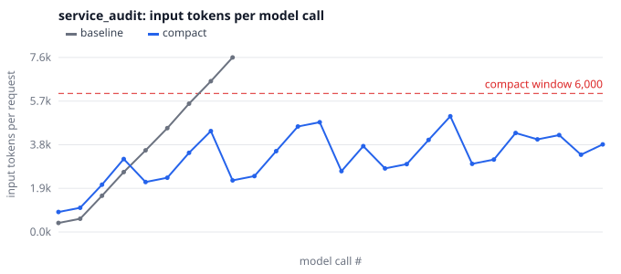

# Results: `openai/gpt-oss-120b` · size=medium · seed=7

- Date: 2026-11-23 23:57  
- Compact window: 6,000 tokens · baseline window: unbounded (provider limit only)  
- Probe (follow-up recall question): on

| Task | Arm | Status | Score | Probe | Calls | Input tokens | Peak request | Output | Folds (model/auto) | Re-reads | Recall/Search | Time |
|---|---|---|---|---|---|---|---|---|---|---|---|---|
| service_audit | baseline | request_too_large | 0.00 | 0.00 | 9 | 32,804 | 7,557 | 519 | – | 0 | – | 168s |
| service_audit | compact | daily_quota | 0.00 | 0.00 | 26 | 83,677 | 5,012 | 4,581 | 4/4 | 6 | 1/1 | 766s |

## service_audit

13 files, ~11,646 tokens of content.

- Total input tokens: compact 83,677 vs baseline 32,804 (-155% fewer)
- Peak request: compact 5,012 vs baseline 7,557 (34% smaller)
- Score: compact 0.00 vs baseline 0.00; probe 0.00 vs 0.00



- **baseline error:** `APIStatusError: Error code: 413 - {'error': {'message': 'Request too large for model `openai/gpt-oss-120b` in organization `org_<redacted>` service tier `on_demand` on tokens per minute (TPM): Limit 8000, Requested 8649, please reduce your message size and try again. Need more tokens`
- **baseline grading:** main {'parsed': False} · probe {}
- **compact error:** `RateLimitError: Error code: 429 - {'error': {'message': 'Rate limit reached for model `openai/gpt-oss-120b` in organization `org_<redacted>` service tier `on_demand` on tokens per day (TPD): Limit 200000, Used 195838, Requested 5071. Please try again in 6m32.688s. Need more tokens? U`
- **compact grading:** main {'parsed': False} · probe {}

<details><summary>Fold log (compact arm)</summary>

**b001** · tier 1 · m0002-m0005 · model · 1,165 → 98 tokens · _initial files analytics and auth_

```
Listed services directory with 12 files. Read analytics.py and auth.py. Extracted SERVICE_CONFIG:
- analytics: name analytics, owner team-orion, region eu-west, timeout_ms 1800, retries 5, max_connections 70, depends_on [payments, scheduler]
- auth: name auth, owner team-atlas, region eu-west, timeout_ms 800, retries 4, max_connections 120, depends_on [payments]
These values stored for later calculations.
```

**b002** · tier 1 · m0006-m0013 · model · 2,384 → 125 tokens · _service configs auth analytics billing_

```
Extracted SERVICE_CONFIG values:
- auth: name='auth', owner='team-atlas', region='eu-west', timeout_ms=800, retries=4, max_connections=120, depends_on=['payments']
- analytics: name='analytics', owner='team-orion', region='eu-west', timeout_ms=1800, retries=5, max_connections=70, depends_on=['payments','scheduler']
- billing: name='billing', owner='team-hermes', region='ap-south', timeout_ms=4000, retries=4, max_connections=230, depends_on=['fraud','search']
```

**b003** · tier 1 · m0014-m0019 · auto · 1,339 → 130 tokens · _auto-folded at context limit_

```
(Auto-folded by the context manager at the context limit. This is a lossy preview; exact text is archived: use search_context or recall_context.)
- m0015 read_file(path='services/billing.py') -> """billing service for the storefront platform. Owned by team-hermes. Generated scaffolding plus hand-written handlers. """ from __future__… [915 tok]
- m0019 list_files(directory='services') -> services/analytics.py (112 lines, ~966 tokens) services/auth.py (124 lines, ~997 tokens) services/billing.py (116 lines, ~911 tokens) servi… [160 tok]
```

**b004** · tier 1 · m0020-m0023 · auto · 3,209 → 136 tokens · _auto-folded at context limit_

```
(Auto-folded by the context manager at the context limit. This is a lossy preview; exact text is archived: use search_context or recall_context.)
- m0021 read_file(path='services/analytics.py') -> """analytics service for the storefront platform. Owned by team-orion. Generated scaffolding plus hand-written handlers. """ from __future_… [970 tok]
- m0023 recall_context(target='b002') -> Archived originals (read-only; the range stays folded): [m0006] ai: read_file({"path": "services/auth.py"}) [m0007] tool: """auth service f… [2,202 tok]
```

**b005** · tier 1 · m0024-m0027 · model · 1,110 → 102 tokens · _list and read billing and analytics_

```
Listed services directory with 12 files. Read billing.py and analytics.py. Extracted SERVICE_CONFIG:
- billing: name='billing', owner='team-hermes', region='ap-south', timeout_ms=4000, retries=4, max_connections=230, depends_on=['fraud','search']
- analytics: name='analytics', owner='team-orion', region='eu-west', timeout_ms=1800, retries=5, max_connections=70, depends_on=['payments','scheduler']
```

**b006** · tier 1 · m0028-m0035 · model · 2,326 → 133 tokens · _read analytics and fraud and list files_

```
Read analytics.py and fraud.py and listed services directory. Extracted SERVICE_CONFIG values:
- analytics: timeout_ms=1800, owner='team-orion', region='eu-west', max_connections=70, retries=5, depends_on=['payments','scheduler']
- fraud: timeout_ms=1800, owner='team-atlas', region='ap-south', max_connections=100, retries=2, depends_on=['auth','scheduler']
- services directory contains 12 files: analytics.py, auth.py, billing.py, fraud.py, gateway.py, media.py, notifications.py, payments.py, recommendations.py, reviews.py, scheduler.py, search.py
```

**b007** · tier 1 · m0036-m0041 · auto · 1,435 → 132 tokens · _auto-folded at context limit_

```
(Auto-folded by the context manager at the context limit. This is a lossy preview; exact text is archived: use search_context or recall_context.)
- m0037 read_file(path='services/auth.py') -> """auth service for the storefront platform. Owned by team-atlas. Generated scaffolding plus hand-written handlers. """ from __future__ imp… [1,001 tok]
- m0041 list_files(directory='services') -> services/analytics.py (112 lines, ~966 tokens) services/auth.py (124 lines, ~997 tokens) services/billing.py (116 lines, ~911 tokens) servi… [160 tok]
```

**b008** · tier 1 · m0042-m0045 · auto · 2,021 → 126 tokens · _auto-folded at context limit_

```
(Auto-folded by the context manager at the context limit. This is a lossy preview; exact text is archived: use search_context or recall_context.)
- m0043 read_file(path='services/gateway.py') -> """gateway service for the storefront platform. Owned by team-atlas. Generated scaffolding plus hand-written handlers. """ from __future__ … [1,037 tok]
- m0045 read_file(path='services/media.py') -> """media service for the storefront platform. Owned by team-nova. Generated scaffolding plus hand-written handlers. """ from __future__ imp… [947 tok]
```

</details>
