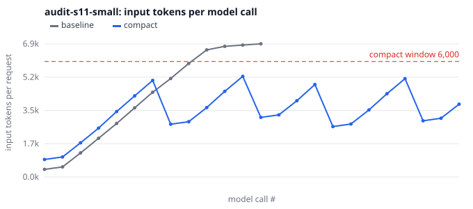

# Results: `openai/gpt-oss-20b` · golden v1

- Date: 2026-11-24 00:36  
- Compact window: 6,000 tokens · baseline window: unbounded (provider limit only)  
- Models that served calls: openai/gpt-oss-20b

| Session | Arm | Status | Turn scores | Mean | Calls | Input tokens | Peak request | Output | Folds (model/auto) | Re-reads | Recall/Search | Time |
|---|---|---|---|---|---|---|---|---|---|---|---|---|
| audit-s11-small | baseline | ok | 1.00 / 1.00 / 1.00 / 1.00 | 1.00 | 13 | 53,126 | 6,918 | 1,380 | – | 0 | – | 492s |
| audit-s11-small | compact | daily_quota | 0.00 / 0.00 / 0.00 / 0.00 | 0.00 | 24 | 80,917 | 5,230 | 1,296 | 0/4 | 13 | 0/0 | 1146s |

## audit-s11-small

9 files, ~5,885 tokens of content.

- Total input tokens: compact 80,917 vs baseline 53,126 (-52% fewer)
- Peak request: compact 5,230 vs baseline 6,918 (24% smaller)
- Mean turn score: compact 0.00 vs baseline 1.00



- **baseline** turn 1 task: 1.00 · {'slow_services_f1': 1.0, 'eu_west_sum': True, 'most_retries': True}
- **baseline** turn 2 probe: 1.00 · {'port': True, 'depends_on': True}
- **baseline** turn 3 followup: 1.00 · {'team': True, 'count': True}
- **baseline** turn 4 followup: 1.00 · {'services': True}
- **compact error** (turn 1 (task)): `DailyQuotaExceeded: TPD quota exhausted for openai/gpt-oss-20b; it frees up in about 15m10s. Re-run with --resume later, or add --fallback-models.`
- **compact** turn 1 task: 0.00 · {}
- **compact** turn 2 probe: 0.00 (skipped) · {}
- **compact** turn 3 followup: 0.00 (skipped) · {}
- **compact** turn 4 followup: 0.00 (skipped) · {}

<details><summary>Fold log (compact arm)</summary>

**b001** · tier 1 · m0002-m0011 · auto · 3,170 → 268 tokens · _auto-folded at context limit_

```
(Auto-folded by the context manager at the context limit. This is a lossy preview; exact text is archived: use search_context or recall_context.)
- m0003 list_files(directory='services') -> services/auth.py (79 lines, ~701 tokens) services/media.py (90 lines, ~734 tokens) services/notifications.py (77 lines, ~741 tokens) servic… [106 tok]
- m0005 read_file(path='services/auth.py') -> """auth service for the storefront platform. Owned by team-nova. Generated scaffolding plus hand-written handlers. """ from __future__ impo… [705 tok]
- m0007 read_file(path='services/media.py') -> """media service for the storefront platform. Owned by team-orion. Generated scaffolding plus hand-written handlers. """ from __future__ im… [738 tok]
- m0009 read_file(path='services/notifications.py') -> """notifications service for the storefront platform. Owned by team-atlas. Generated scaffolding plus hand-written handlers. """ from __fut… [745 tok]
- m0011 read_file(path='services/reviews.py') -> """reviews service for the storefront platform. Owned by team-ledger. Generated scaffolding plus hand-written handlers. """ from __future__… [786 tok]
```

**b002** · tier 1 · m0012-m0021 · auto · 3,114 → 268 tokens · _auto-folded at context limit_

```
(Auto-folded by the context manager at the context limit. This is a lossy preview; exact text is archived: use search_context or recall_context.)
- m0013 read_file(path='services/scheduler.py') -> """scheduler service for the storefront platform. Owned by team-atlas. Generated scaffolding plus hand-written handlers. """ from __future_… [784 tok]
- m0015 read_file(path='services/sessions.py') -> """sessions service for the storefront platform. Owned by team-atlas. Generated scaffolding plus hand-written handlers. """ from __future__… [691 tok]
- m0017 list_files(directory='services') -> services/auth.py (79 lines, ~701 tokens) services/media.py (90 lines, ~734 tokens) services/notifications.py (77 lines, ~741 tokens) servic… [106 tok]
- m0019 read_file(path='services/auth.py') -> """auth service for the storefront platform. Owned by team-nova. Generated scaffolding plus hand-written handlers. """ from __future__ impo… [705 tok]
- m0021 read_file(path='services/media.py') -> """media service for the storefront platform. Owned by team-orion. Generated scaffolding plus hand-written handlers. """ from __future__ im… [738 tok]
```

**b003** · tier 1 · m0022-m0031 · auto · 3,170 → 268 tokens · _auto-folded at context limit_

```
(Auto-folded by the context manager at the context limit. This is a lossy preview; exact text is archived: use search_context or recall_context.)
- m0023 read_file(path='services/notifications.py') -> """notifications service for the storefront platform. Owned by team-atlas. Generated scaffolding plus hand-written handlers. """ from __fut… [745 tok]
- m0025 read_file(path='services/reviews.py') -> """reviews service for the storefront platform. Owned by team-ledger. Generated scaffolding plus hand-written handlers. """ from __future__… [786 tok]
- m0027 list_files(directory='services') -> services/auth.py (79 lines, ~701 tokens) services/media.py (90 lines, ~734 tokens) services/notifications.py (77 lines, ~741 tokens) servic… [106 tok]
- m0029 read_file(path='services/auth.py') -> """auth service for the storefront platform. Owned by team-nova. Generated scaffolding plus hand-written handlers. """ from __future__ impo… [705 tok]
- m0031 read_file(path='services/media.py') -> """media service for the storefront platform. Owned by team-orion. Generated scaffolding plus hand-written handlers. """ from __future__ im… [738 tok]
```

**b004** · tier 1 · m0032-m0041 · auto · 3,168 → 268 tokens · _auto-folded at context limit_

```
(Auto-folded by the context manager at the context limit. This is a lossy preview; exact text is archived: use search_context or recall_context.)
- m0033 read_file(path='services/scheduler.py') -> """scheduler service for the storefront platform. Owned by team-atlas. Generated scaffolding plus hand-written handlers. """ from __future_… [784 tok]
- m0035 list_files(directory='services') -> services/auth.py (79 lines, ~701 tokens) services/media.py (90 lines, ~734 tokens) services/notifications.py (77 lines, ~741 tokens) servic… [106 tok]
- m0037 read_file(path='services/auth.py') -> """auth service for the storefront platform. Owned by team-nova. Generated scaffolding plus hand-written handlers. """ from __future__ impo… [705 tok]
- m0039 read_file(path='services/media.py') -> """media service for the storefront platform. Owned by team-orion. Generated scaffolding plus hand-written handlers. """ from __future__ im… [738 tok]
- m0041 read_file(path='services/notifications.py') -> """notifications service for the storefront platform. Owned by team-atlas. Generated scaffolding plus hand-written handlers. """ from __fut… [745 tok]
```

</details>
