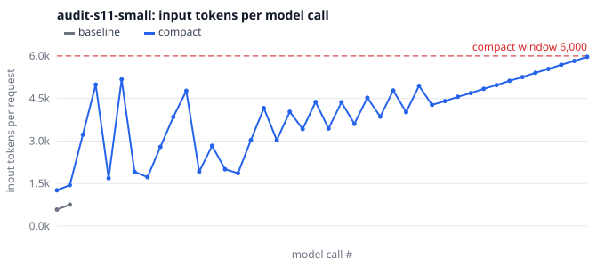
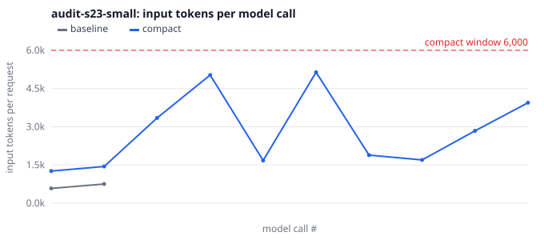

# Results: `qwen/qwen3.8-27b` · golden v1

- Date: 2026-11-24 00:36  
- Compact window: 6,000 tokens · baseline window: unbounded (provider limit only)  
- Models that served calls: qwen/qwen3.8-27b

| Session | Arm | Status | Turn scores | Mean | Calls | Input tokens | Peak request | Output | Folds (model/auto) | Re-reads | Recall/Search | Time |
|---|---|---|---|---|---|---|---|---|---|---|---|---|
| audit-s11-small | baseline | request_too_large | 0.00 / 0.00 / 0.00 / 0.00 | 0.00 | 2 | 1,336 | 756 | 248 | – | 0 | – | 1s |
| audit-s11-small | compact | context_overflow | 0.00 / 0.00 / 0.00 / 0.00 | 0.00 | 42 | 163,623 | 5,973 | 2,399 | 6/20 | 1 | 31/0 | 2195s |
| audit-s23-small | baseline | request_too_large | 0.00 / 0.00 / 0.00 / 0.00 | 0.00 | 2 | 1,335 | 755 | 247 | – | 0 | – | 52s |
| audit-s23-small | compact | daily_quota | 0.00 / 0.00 / 0.00 / 0.00 | 0.00 | 10 | 28,268 | 5,140 | 942 | 3/1 | 0 | 3/0 | 557s |

## audit-s11-small

9 files, ~5,885 tokens of content.

- Total input tokens: compact 163,623 vs baseline 1,336 (-12147% fewer)
- Peak request: compact 5,973 vs baseline 756 (-690% smaller)
- Mean turn score: compact 0.00 vs baseline 0.00



- **baseline error** (turn 1 (task)): `APIStatusError: Error code: 413 - {'error': {'message': 'Request too large for model `qwen/qwen3.8-27b` in organization `org_<redacted>` service tier `on_demand` on input tokens per minute (ITPM): Limit 7000, Requested 7538, please reduce your message size and try again. Need more tokens? Upgrade to`
- **baseline** turn 1 task: 0.00 · {}
- **baseline** turn 2 probe: 0.00 (skipped) · {}
- **baseline** turn 3 followup: 0.00 (skipped) · {}
- **baseline** turn 4 followup: 0.00 (skipped) · {}
- **compact error** (turn 1 (task)): `ContextOverflowError: request needs ~6,103 tokens but the window is 6,000`
- **compact** turn 1 task: 0.00 · {}
- **compact** turn 2 probe: 0.00 (skipped) · {}
- **compact** turn 3 followup: 0.00 (skipped) · {}
- **compact** turn 4 followup: 0.00 (skipped) · {}

<details><summary>Fold log (compact arm)</summary>

**b001** · tier 1 · m0002-m0009 · model · 3,162 → 177 tokens (merged into a higher tier) · _SERVICE_CONFIG of auth, media, notifications, reviews_

```
Read 4 of 8 service files. SERVICE_CONFIG values (ignore changelog comments):
- auth: owner team-nova, region eu-west, timeout_ms 1500, retries 0, max_connections 380, depends_on [media, shipping]
- media: owner team-orion, region us-east, timeout_ms 3000, retries 5, max_connections 140, depends_on [auth, sessions]
- notifications: owner team-atlas, region eu-west, timeout_ms 800, retries 1, max_connections 190, depends_on [auth, scheduler]
- reviews: owner team-ledger, region us-east, timeout_ms 1800, retries 4, max_connections 180, depends_on [notifications, scheduler]
Remaining to read: services/scheduler.py, services/sessions.py, services/shipping.py, services/webhooks.py.
```

**b002** · tier 1 · m0012-m0016 · model · 2,976 → 157 tokens · _SERVICE_CONFIG of scheduler, sessions, shipping, webhooks_

```
SERVICE_CONFIG of remaining 4 services (changelog comments ignored):
- scheduler: owner team-atlas, region ap-south, timeout_ms 1200, retries 3, max_connections 210, depends_on [auth, sessions]
- sessions: owner team-atlas, region ap-south, timeout_ms 2500, retries 2, max_connections 180, depends_on [auth, notifications]
- shipping: owner team-atlas, region eu-west, timeout_ms 1200, retries 3, max_connections 100, depends_on [auth, reviews]
- webhooks: owner team-atlas, region eu-west, timeout_ms 2000, retries 1, max_connections 170, depends_on [auth]
All 8 services now read.
```

**b003** · tier 2 · m0002-m0009 · model · 207 → 10 tokens · _SERVICE_CONFIG of auth, media, notifications, reviews_

```
(kept as your notes for this fold)
```

**b004** · tier 1 · m0021-m0026 · model · 2,552 → 130 tokens (merged into a higher tier) · _SERVICE_CONFIG of auth, media, notifications_

```
SERVICE_CONFIG values (changelog comments ignored):
- auth: owner team-nova, region eu-west, timeout_ms 1500, retries 0, max_connections 380, depends_on [media, shipping]
- media: owner team-orion, region us-east, timeout_ms 3000, retries 5, max_connections 140, depends_on [auth, sessions]
- notifications: owner team-atlas, region eu-west, timeout_ms 800, retries 1, max_connections 190, depends_on [auth, scheduler]
- reviews: NOT YET READ — services/reviews.py (88 lines) still needs reading.
```

**b005** · tier 1 · m0027-m0030 · model · 1,043 → 42 tokens · _reviews SERVICE_CONFIG_

```
reviews SERVICE_CONFIG: owner team-ledger, region us-east, timeout_ms 1800, retries 4, max_connections 180, depends_on [notifications, scheduler]. All 8 services now read.
```

**b006** · tier 2 · m0021-m0026 · model · 160 → 10 tokens · _auth, media, notifications SERVICE_CONFIG_

```
(kept as your notes for this fold)
```

**b007** · tier 1 · m0035-m0038 · auto · 1,882 → 144 tokens · _auto-folded at context limit_

```
(Auto-folded by the context manager at the context limit. This is a lossy preview; exact text is archived: use search_context or recall_context.)
- m0036 recall_context(target='b006') -> Archived originals (read-only; the range stays folded): [m0021] ai: recall_context({"target": "b003"}) [m0022] tool: Archived originals (re… [973 tok]
- m0038 recall_context(target='m0024-m0026') -> Archived originals (read-only; the range stays folded): [m0024] tool: Archived originals (read-only; the range stays folded): [m0006] tool:… [869 tok]
```

**b008** · tier 1 · m0039-m0042 · auto · 1,691 → 146 tokens · _auto-folded at context limit_

```
(Auto-folded by the context manager at the context limit. This is a lossy preview; exact text is archived: use search_context or recall_context.)
- m0040 recall_context(target='m0026-m0026') -> Archived originals (read-only; the range stays folded): [m0026] tool: Archived originals (read-only; the range stays folded): [m0008] tool:… [803 tok]
- m0042 recall_context(target='m0024-m0025') -> Archived originals (read-only; the range stays folded): [m0024] tool: Archived originals (read-only; the range stays folded): [m0006] tool:… [844 tok]
```

**b009** · tier 1 · m0043-m0046 · auto · 1,784 → 144 tokens · _auto-folded at context limit_

```
(Auto-folded by the context manager at the context limit. This is a lossy preview; exact text is archived: use search_context or recall_context.)
- m0044 recall_context(target='m0022-m0023') -> Archived originals (read-only; the range stays folded): [m0022] tool: Archived originals (read-only; the range stays folded): [m0002] ai: l… [932 tok]
- m0046 recall_context(target='m0006-m0009') -> Archived originals (read-only; the range stays folded): [m0006] tool: """media service for the storefront platform. Owned by team-orion. Ge… [808 tok]
```

**b010** · tier 1 · m0047-m0050 · auto · 1,613 → 137 tokens · _auto-folded at context limit_

```
(Auto-folded by the context manager at the context limit. This is a lossy preview; exact text is archived: use search_context or recall_context.)
- m0048 recall_context(target='m0008-m0009') -> Archived originals (read-only; the range stays folded): [m0008] tool: """notifications service for the storefront platform. Owned by team-a… [786 tok]
- m0050 recall_context(target='m0006-m0007') -> Archived originals (read-only; the range stays folded): [m0006] tool: """media service for the storefront platform. Owned by team-orion. Ge… [783 tok]
```

**b011** · tier 1 · m0051-m0054 · auto · 1,576 → 143 tokens · _auto-folded at context limit_

```
(Auto-folded by the context manager at the context limit. This is a lossy preview; exact text is archived: use search_context or recall_context.)
- m0052 recall_context(target='m0004-m0005') -> Archived originals (read-only; the range stays folded): [m0004] ai: read_file({"path": "services/auth.py"}) read_file({"path": "services/me… [749 tok]
- m0054 recall_context(target='m0006-m0007') -> Archived originals (read-only; the range stays folded): [m0006] tool: """media service for the storefront platform. Owned by team-orion. Ge… [783 tok]
```

**b012** · tier 1 · m0055-m0058 · auto · 1,613 → 137 tokens · _auto-folded at context limit_

```
(Auto-folded by the context manager at the context limit. This is a lossy preview; exact text is archived: use search_context or recall_context.)
- m0056 recall_context(target='m0008-m0009') -> Archived originals (read-only; the range stays folded): [m0008] tool: """notifications service for the storefront platform. Owned by team-a… [786 tok]
- m0058 recall_context(target='m0006-m0007') -> Archived originals (read-only; the range stays folded): [m0006] tool: """media service for the storefront platform. Owned by team-orion. Ge… [783 tok]
```

**b013** · tier 1 · m0059-m0062 · auto · 1,576 → 143 tokens · _auto-folded at context limit_

```
(Auto-folded by the context manager at the context limit. This is a lossy preview; exact text is archived: use search_context or recall_context.)
- m0060 recall_context(target='m0004-m0005') -> Archived originals (read-only; the range stays folded): [m0004] ai: read_file({"path": "services/auth.py"}) read_file({"path": "services/me… [749 tok]
- m0062 recall_context(target='m0006-m0007') -> Archived originals (read-only; the range stays folded): [m0006] tool: """media service for the storefront platform. Owned by team-orion. Ge… [783 tok]
```

**b014** · tier 1 · m0063-m0064 · auto · 808 → 83 tokens · _auto-folded at context limit_

```
(Auto-folded by the context manager at the context limit. This is a lossy preview; exact text is archived: use search_context or recall_context.)
- m0064 recall_context(target='m0008-m0009') -> Archived originals (read-only; the range stays folded): [m0008] tool: """notifications service for the storefront platform. Owned by team-a… [786 tok]
```

**b015** · tier 1 · m0065-m0066 · auto · 805 → 86 tokens · _auto-folded at context limit_

```
(Auto-folded by the context manager at the context limit. This is a lossy preview; exact text is archived: use search_context or recall_context.)
- m0066 recall_context(target='m0006-m0007') -> Archived originals (read-only; the range stays folded): [m0006] tool: """media service for the storefront platform. Owned by team-orion. Ge… [783 tok]
```

**b016** · tier 1 · m0067-m0068 · auto · 808 → 83 tokens · _auto-folded at context limit_

```
(Auto-folded by the context manager at the context limit. This is a lossy preview; exact text is archived: use search_context or recall_context.)
- m0068 recall_context(target='m0008-m0009') -> Archived originals (read-only; the range stays folded): [m0008] tool: """notifications service for the storefront platform. Owned by team-a… [786 tok]
```

**b017** · tier 1 · m0069-m0070 · auto · 805 → 86 tokens · _auto-folded at context limit_

```
(Auto-folded by the context manager at the context limit. This is a lossy preview; exact text is archived: use search_context or recall_context.)
- m0070 recall_context(target='m0006-m0007') -> Archived originals (read-only; the range stays folded): [m0006] tool: """media service for the storefront platform. Owned by team-orion. Ge… [783 tok]
```

**b018** · tier 1 · m0071-m0072 · auto · 808 → 83 tokens · _auto-folded at context limit_

```
(Auto-folded by the context manager at the context limit. This is a lossy preview; exact text is archived: use search_context or recall_context.)
- m0072 recall_context(target='m0008-m0009') -> Archived originals (read-only; the range stays folded): [m0008] tool: """notifications service for the storefront platform. Owned by team-a… [786 tok]
```

**b019** · tier 1 · m0073-m0074 · auto · 805 → 86 tokens · _auto-folded at context limit_

```
(Auto-folded by the context manager at the context limit. This is a lossy preview; exact text is archived: use search_context or recall_context.)
- m0074 recall_context(target='m0006-m0007') -> Archived originals (read-only; the range stays folded): [m0006] tool: """media service for the storefront platform. Owned by team-orion. Ge… [783 tok]
```

**b020** · tier 1 · m0075-m0076 · auto · 808 → 83 tokens · _auto-folded at context limit_

```
(Auto-folded by the context manager at the context limit. This is a lossy preview; exact text is archived: use search_context or recall_context.)
- m0076 recall_context(target='m0008-m0009') -> Archived originals (read-only; the range stays folded): [m0008] tool: """notifications service for the storefront platform. Owned by team-a… [786 tok]
```

**b021** · tier 1 · m0077-m0078 · auto · 805 → 86 tokens · _auto-folded at context limit_

```
(Auto-folded by the context manager at the context limit. This is a lossy preview; exact text is archived: use search_context or recall_context.)
- m0078 recall_context(target='m0006-m0007') -> Archived originals (read-only; the range stays folded): [m0006] tool: """media service for the storefront platform. Owned by team-orion. Ge… [783 tok]
```

**b022** · tier 1 · m0079-m0080 · auto · 808 → 83 tokens · _auto-folded at context limit_

```
(Auto-folded by the context manager at the context limit. This is a lossy preview; exact text is archived: use search_context or recall_context.)
- m0080 recall_context(target='m0008-m0009') -> Archived originals (read-only; the range stays folded): [m0008] tool: """notifications service for the storefront platform. Owned by team-a… [786 tok]
```

**b023** · tier 1 · m0081-m0082 · auto · 805 → 86 tokens · _auto-folded at context limit_

```
(Auto-folded by the context manager at the context limit. This is a lossy preview; exact text is archived: use search_context or recall_context.)
- m0082 recall_context(target='m0006-m0007') -> Archived originals (read-only; the range stays folded): [m0006] tool: """media service for the storefront platform. Owned by team-orion. Ge… [783 tok]
```

**b024** · tier 1 · m0083-m0084 · auto · 808 → 83 tokens · _auto-folded at context limit_

```
(Auto-folded by the context manager at the context limit. This is a lossy preview; exact text is archived: use search_context or recall_context.)
- m0084 recall_context(target='m0008-m0009') -> Archived originals (read-only; the range stays folded): [m0008] tool: """notifications service for the storefront platform. Owned by team-a… [786 tok]
```

**b025** · tier 1 · m0085-m0086 · auto · 805 → 86 tokens · _auto-folded at context limit_

```
(Auto-folded by the context manager at the context limit. This is a lossy preview; exact text is archived: use search_context or recall_context.)
- m0086 recall_context(target='m0006-m0007') -> Archived originals (read-only; the range stays folded): [m0006] tool: """media service for the storefront platform. Owned by team-orion. Ge… [783 tok]
```

**b026** · tier 1 · m0087-m0088 · auto · 808 → 83 tokens · _auto-folded at context limit_

```
(Auto-folded by the context manager at the context limit. This is a lossy preview; exact text is archived: use search_context or recall_context.)
- m0088 recall_context(target='m0008-m0009') -> Archived originals (read-only; the range stays folded): [m0008] tool: """notifications service for the storefront platform. Owned by team-a… [786 tok]
```

</details>

## audit-s23-small

9 files, ~5,897 tokens of content.

- Total input tokens: compact 28,268 vs baseline 1,335 (-2017% fewer)
- Peak request: compact 5,140 vs baseline 755 (-581% smaller)
- Mean turn score: compact 0.00 vs baseline 0.00



- **baseline error** (turn 1 (task)): `APIStatusError: Error code: 413 - {'error': {'message': 'Request too large for model `qwen/qwen3.8-27b` in organization `org_<redacted>` service tier `on_demand` on input tokens per minute (ITPM): Limit 7000, Requested 7554, please reduce your message size and try again. Need more tokens? Upgrade to`
- **baseline** turn 1 task: 0.00 · {}
- **baseline** turn 2 probe: 0.00 (skipped) · {}
- **baseline** turn 3 followup: 0.00 (skipped) · {}
- **baseline** turn 4 followup: 0.00 (skipped) · {}
- **compact error** (turn 1 (task)): `DailyQuotaExceeded: TPD quota exhausted for qwen/qwen3.8-27b; it frees up in about 24m34s. Re-run with --resume later, or add --fallback-models.`
- **compact** turn 1 task: 0.00 · {}
- **compact** turn 2 probe: 0.00 (skipped) · {}
- **compact** turn 3 followup: 0.00 (skipped) · {}
- **compact** turn 4 followup: 0.00 (skipped) · {}

<details><summary>Fold log (compact arm)</summary>

**b001** · tier 1 · m0002-m0009 · model · 3,200 → 176 tokens (merged into a higher tier) · _service configs 1-4_

```
Read 4 of 8 service files. SERVICE_CONFIG values (ignore changelog comments):
- analytics: owner team-nova, region eu-west, timeout_ms 1200, retries 0, max_connections 350, depends_on ["auth"]
- auth: owner team-orion, region ap-south, timeout_ms 2500, retries 2, max_connections 70, depends_on []
- catalog: owner team-atlas, region ap-south, timeout_ms 2200, retries 5, max_connections 150, depends_on ["auth","scheduler"]
- inventory: owner team-ledger, region ap-south, timeout_ms 2200, retries 4, max_connections 220, depends_on ["auth","catalog","notifications"]
Still to read: services/media.py, services/notifications.py, services/scheduler.py, services/webhooks.py.
```

**b002** · tier 1 · m0012-m0016 · model · 2,948 → 145 tokens · _service configs 5-8_

```
SERVICE_CONFIG values (changelog ignored):
- media: owner team-atlas, region eu-west, timeout_ms 1500, retries 5, max_connections 340, depends_on ["inventory","webhooks"]
- notifications: owner team-vega, region ap-south, timeout_ms 1500, retries 1, max_connections 150, depends_on ["auth","catalog","scheduler"]
- scheduler: owner team-orion, region eu-west, timeout_ms 1200, retries 0, max_connections 100, depends_on ["analytics"]
- webhooks: owner team-orion, region us-east, timeout_ms 2000, retries 4, max_connections 250, depends_on ["auth"]
```

**b003** · tier 2 · m0002-m0009 · model · 206 → 10 tokens · _service configs 1-4_

```
(kept as your notes for this fold)
```

**b004** · tier 1 · m0021-m0024 · auto · 1,854 → 139 tokens · _auto-folded at context limit_

```
(Auto-folded by the context manager at the context limit. This is a lossy preview; exact text is archived: use search_context or recall_context.)
- m0022 recall_context(target='b003') -> Archived originals (read-only; the range stays folded): [m0002] ai: list_files({"directory": "services"}) [m0003] tool: services/analytics.… [967 tok]
- m0024 recall_context(target='m0006-m0009') -> Archived originals (read-only; the range stays folded): [m0006] tool: """auth service for the storefront platform. Owned by team-orion. Gen… [847 tok]
```

</details>
